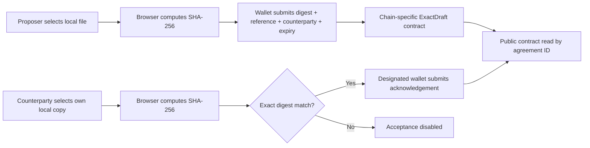

# Technical and privacy framework

## Current architecture

The frontend is Next.js/TypeScript with wagmi/viem. The contract is Solidity 0.8.24 and stores proposer address, counterparty address, `bytes32` file hash, reference string, timestamps, and status. It emits created/accepted/cancelled events and exposes `agreementCount` and `getAgreement`. Agreement IDs are one-based and deployment-local. Reads are direct contract calls; there is no app database, backend, or event indexer today.

Supported network configuration in source:

| Network | Chain ID | RPC | Explorer | Contract address |
| --- | ---: | --- | --- | --- |
| Monad testnet | 10143 | `https://testnet-rpc.monad.xyz` | `https://testnet.monadvision.com` | Existing address documented in root README; verify before use |
| BOT Chain testnet | 968 | `https://rpc.bohr.life` | `https://scan.bohr.life` | Not configured/deployed in this checkout |

BOT values are current code/documentation values, not a guarantee of present service availability. Confirm before deployment. The app reports transaction receipt inclusion as confirmed; do not describe that UI state as protocol finality.

## Trust and permission boundaries

- File selection and hashing happen in the browser. The current flow does not send the file or `Blob` to an ExactDraft API, backend, storage service, or contract.
- Wallets sign their own chain transactions. The deployer key is separate, test-only, and must never enter frontend/public environment variables or this repository.
- Any wallet can read public chain state. Only the proposer can cancel a pending record; only the designated counterparty can acknowledge, and acceptance requires the exact stored digest before expiry.
- The contract records a submitted digest. It cannot establish which file was selected or whether a person possesses, opened, read, or understood it.
- Contract source is not upgradeable. A deployed contract’s behavior cannot be changed by updating this repository.

## Data inventory and risk controls

| Data | Current handling | Exposure / control |
| --- | --- | --- |
| File bytes | Selected locally and hashed in browser | Not intentionally uploaded by the app flow. Do not select sensitive files for partner demos. Browser extensions, device compromise, or user actions are outside this guarantee. |
| File name | Local component state for display | Not written onchain by the current flow. Avoid screenshots that reveal private names. |
| SHA-256 digest | Sent in transaction and stored/emitted publicly | Permanent and linkable. Known or guessable documents may be matched by hashing candidate copies. Use synthetic files; consider a separately designed commitment/salt scheme only if a real use case justifies it. |
| Wallet addresses | Public proposer/counterparty and transaction signers | Linkable to other chain activity. Use test wallets for demos. |
| Reference and timestamps | Stored/emitted publicly | Never put names, client identifiers, contract titles, or confidential context in the reference. Use opaque, non-sensitive labels. |
| Private keys | Wallet/provider managed; deploy key supplied out of band | Never commit keys, place them in `NEXT_PUBLIC_*`, or paste them into logs/reports. Use disposable testnet keys with minimal funds. |
| RPC metadata | Public RPC requests from browser | RPC operators may observe addresses, IDs, and query timing. Avoid representing direct public RPC reads as anonymous. |

No contract event or hash is a substitute for identity, authority, electronic-signature, retention, or legal review. Obtain appropriate legal and security review before using this pattern for high-stakes transactions.

## BOT readiness gates

Before calling the BOT integration deployed, record all of the following:

1. Confirm endpoint responds with expected `eth_chainId` and confirm explorer/faucet details from official sources or BOT staff.
2. Deploy only the reviewed repository source using the intended Solidity version, optimizer/EVM settings, and a disposable testnet wallet.
3. Preserve deployment transaction, receipt, address, block number, source revision, compiler metadata, and deployer identity (public address only).
4. Verify/publish source through BOTScan or record a reproducible blocker.
5. Configure the BOT address through `NEXT_PUBLIC_BOT_EXACTDRAFT_CONTRACT_ADDRESS`, rebuild/restart, and check that the app sees code at that address.
6. Complete two-wallet synthetic tests on chain 968: exact match, mismatch blocked, wrong signer rejected, cancellation, expiry, reload, explorer links, and RPC/wallet recovery.
7. Record transaction hashes and receipt statuses. Report inclusion separately from the chain’s finality guarantee.

## Next technical decisions

- Ask BOT staff about RPC quotas, rate limits, service ownership, incident communications, and whether public RPC is suitable for a small invited pilot.
- Keep direct reads by ID for a small pilot. Add an indexer only if measured history/discovery needs or RPC limits make direct reads inadequate.
- Confirm how BOTScan verifies contracts and which metadata/compiler settings it expects.
- Define a contract-address release/configuration process so an incorrect address fails closed, as the app currently intends.
